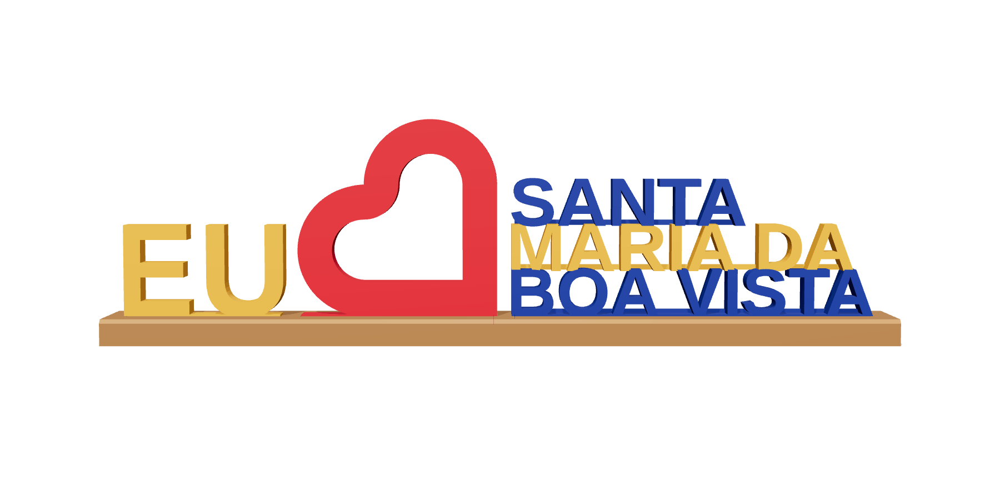

# Placa "EU ❤ SANTA MARIA DA BOA VISTA" (impressão 3D)

Réplica do letreiro da orla em miniatura para mesa, com posições e proporções medidas na foto, sem a plaquinha do lado e com a base inteira em marrom. 240 × 30 mm de base, ~70 mm de altura (coração).

| Arquivo | Cor | Filamento | Tempo* |
|---|---|---|---|
| `base.stl` | marrom | ~26 g | ~46 min |
| `eu.stl` | amarelo | ~5 g | ~10 min |
| `coracao.stl` | vermelho | ~9 g | ~16 min |
| `texto-azul.stl` (SANTA e BOA VISTA) | azul | ~13 g | ~47 min |
| `texto-amarelo.stl` (MARIA DA) | amarelo | ~7 g | ~30 min |
| **Total** | 4 cores | **~60 g** | **~2,5–3 h** |

\* PrusaSlicer com velocidades de impressora rápida (Bambu A1 / Kobra X), camada 0,2 mm, 2 paredes, 15% giroide. Em impressora comum, ~2× mais.

## Imprimir
Tudo deitado, como o STL vem, sem suporte (nas linhas do texto, a face com o filete fica na mesa). Cada peça numa cor só, então não precisa de AMS: dá para imprimir uma cor por vez em qualquer impressora com mesa de 240 mm (numa de 220 × 220, a base vai na diagonal).

As letras de cada linha do texto são ligadas por um filete fino atrás, na linha de base (1,6 mm), que de frente quase não aparece e deixa cada linha numa peça só.

## Montar
1. Encaixe a aba de baixo do EU, do coração e do BOA VISTA nos rasgos da base (uma gota de cola em cada).
2. Cole o MARIA DA em cima do BOA VISTA e o SANTA em cima do MARIA DA, alinhados à esquerda.

## Ajustar
Medidas no topo do `gerar.py` (comprimento, espessura das letras, altura do EU, tamanho do coração, folga dos rasgos). `python3 gerar.py` refaz os STLs e `frente.png`. Imagem 3D: `python3 -m http.server 8766` nesta pasta e `node render/fotos.mjs`.

Fonte: Arimo Bold (SIL Open Font License 1.1; mesmo desenho do Arial Bold do letreiro), `Arimo-Bold.ttf`.
