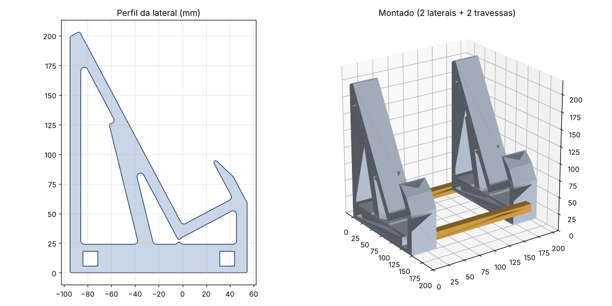

# Suporte para Vade Mecum (impressão 3D)

Atril para estudar com o Vade Mecum aberto, inclinado a 62°. São 4 peças, todas cabem numa mesa de 220 × 220 mm e imprimem sem suporte.



| Arquivo | Quantidade | Medidas | Como imprimir |
|---|---|---|---|
| `lateral.stl` | 2 | 149 × 203 × 40 mm | deitada, com o perfil na mesa (do jeito que o STL já vem) |
| `travessa.stl` | 2 | 210 × 12 × 12 mm | deitada |

Montagem: passe as duas travessas pelos furos quadrados das bases das duas laterais e deixe as pontas rentes por fora. O livro aberto apoia a borda de baixo no aparador (48 mm de fundo, cabe meia lombada do Vade Mecum) e a aba da frente segura as páginas. Largura total: 210 mm; o livro aberto (~34 cm) passa um pouco para cada lado, o que é normal.

Configuração sugerida: PLA ou PETG, camada 0,2 mm, 3 paredes, 20% de preenchimento (giroide ou grade). Cada lateral leva umas 4–5 h e ~120 g.

## Ajustar
Os parâmetros ficam no topo do `gerar.py` (ângulo, comprimento da rampa, fundo do aparador, altura da aba, vão entre as laterais, folga do encaixe). Mude e rode:

```bash
pip install trimesh shapely manifold3d mapbox_earcut matplotlib
python3 gerar.py
```

Se a travessa ficar frouxa, diminua `FOLGA` (0,25 mm por lado); se não entrar, aumente para 0,35. Para um livro mais grosso, aumente `APARADOR`.
