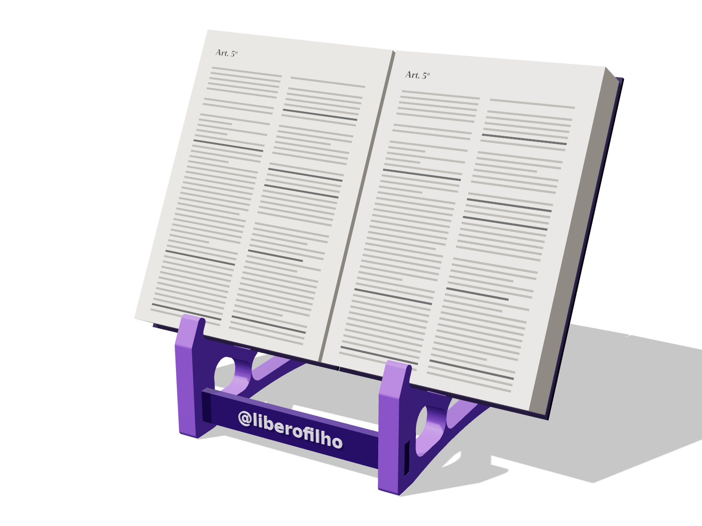

# Suporte para Vade Mecum (impressão 3D)

## Versão leve (recomendada para vender)
Pasta `leve/`: laterais em forma de vela (contorno contínuo, base em arco), em tons de roxo, placa da frente com @liberofilho em relevo (troca de filamento na camada do relevo para o @ sair em outra cor). Aparador de 72 mm: cabe o lado grosso do Vade Mecum aberto no começo ou no fim. Gasta ~130 g e ~9 h (PrusaSlicer, camada 0,28, 2 paredes, 15% giroide), contra ~390 g e ~30 h da versão robusta abaixo. Aguenta 3 kg com folga de ~15× no ponto mais exigido.



| Arquivo | Qtd. | Medidas |
|---|---|---|
| `leve/lateral.stl` | 2 | 185 × 193 × 15 mm |
| `leve/placa.stl` | 1 | 180 × 24 × 8 mm (@ para cima na impressão) |
| `leve/travessa.stl` | 1 | 180 × 9 × 9 mm |

Gerar com outro texto na placa: `python3 leve/gerar.py "OAB 2027"` (padrão: @liberofilho). Imagens 3D (three.js): `python3 -m http.server 8765 -d leve` e, em outro terminal, `node leve/render/fotos.mjs`.

## Versão robusta (a primeira)

Atril para estudar com o Vade Mecum aberto, inclinado a 62°. São 4 peças, todas cabem numa mesa de 220 × 220 mm e imprimem sem suporte.


| Arquivo | Quantidade | Medidas | Como imprimir |
|---|---|---|---|
| `lateral.stl` | 2 | 149 × 203 × 40 mm | deitada, com o perfil na mesa (do jeito que o STL já vem) |
| `travessa.stl` | 2 | 210 × 12 × 12 mm | deitada |

Montagem: passe as duas travessas pelos furos quadrados das bases das duas laterais e deixe as pontas rentes por fora. O livro aberto apoia a borda de baixo no aparador (48 mm de fundo, cabe meia lombada do Vade Mecum) e a aba da frente segura as páginas. Largura total: 210 mm; o livro aberto (~34 cm) passa um pouco para cada lado, o que é normal.

Configuração sugerida: PLA ou PETG, camada 0,2 mm, 3 paredes, 20% de preenchimento (giroide ou grade). Cada lateral leva ~13,5 h e ~180 g (medido no PrusaSlicer, impressora comum).

## Ajustar
Os parâmetros ficam no topo do `gerar.py` (ângulo, comprimento da rampa, fundo do aparador, altura da aba, vão entre as laterais, folga do encaixe). Mude e rode:

```bash
pip install trimesh shapely manifold3d mapbox_earcut matplotlib
python3 gerar.py
```

Se a travessa ficar frouxa, diminua `FOLGA` (0,25 mm por lado); se não entrar, aumente para 0,35. Para um livro mais grosso, aumente `APARADOR`.

## PDF
`suporte-vade-mecum.pdf`: ficha técnica da versão leve, gasto medido no fatiador, custo, preço de venda e estratégia. Fonte em `pdf/ficha.html` (`node pdf/gerar-pdf.mjs`, depois de gerar as imagens da versão leve).

`guia-producao.pdf`: guia para produzir e vender (quanto aguenta, impressoras com links, orçamentos, impressão, montagem e envio). Fonte em `pdf/guia.html` (`node pdf/gerar-guia.mjs`).
