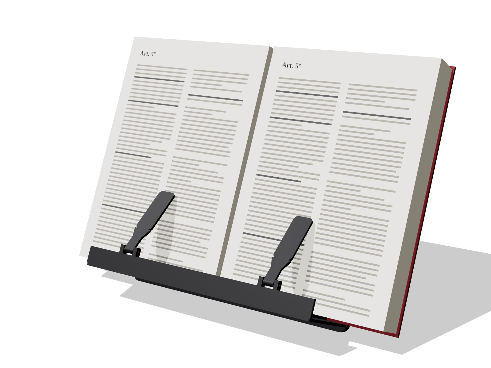

# Suporte para Vade Mecum v2 (projeto novo)

Feito do zero depois do teste da versão leve: lá o livro só encostava nas duas laterais e o meio aberto (a lombada) afundava no vão entre elas. Aqui o livro encosta numa **prancha inteira** e apoia num **aparador corrido** de ponta a ponta, e dois **prendedores com dobradiça** deitam sobre as páginas pelo próprio peso.

| Arquivo | Qtd. | Medidas | Filamento* | Tempo* |
|---|---|---|---|---|
| `prancha.stl` | 1 | 240 × 200 × 7 mm | ~97 g | ~2h35 |
| `aparador.stl` | 1 | 240 × 83 × 26 mm | ~60 g | ~1h30 |
| `perna.stl` | 2 | 135 × 163 × 5 mm | ~16 g cada | ~27 min cada |
| `prendedor.stl` | 2 | 18 × 75 × 6 mm | ~3 g cada | ~7 min cada |
| **Total** | 6 peças | montado: 240 × ~135 × ~185 mm | **~195 g** | **~5–6 h** |

\* PrusaSlicer com velocidades de impressora rápida (Kobra X / Bambu A1), camada 0,2 mm, 3 paredes, 15% giroide. A prancha e o aparador pedem mesa de pelo menos 256 × 256 mm.

## Imprimir
Tudo deitado, como o STL vem, sem suporte: a prancha com a face lisa para baixo; o aparador com a aba para cima.

## Montar
1. **Aparador:** encaixe a lingueta de trás na ranhura da faixa de baixo da prancha (face lisa). Passe cola em gel na lingueta antes: é ela que segura o peso do livro.
2. **Pernas:** encaixe cada perna no trilho de trás da prancha, até encostar na faixa de baixo. Uma gota de cola em cada trilho.
3. **Prendedores:** coloque cada prendedor entre as duas orelhas da aba e passe um pedaço de 22 mm de filamento (1,75 mm) pelos furos, como pino. Uma gota de cola nas pontas do pino, só nas orelhas (o prendedor tem que girar livre).

## Usar
Abra o Vade Mecum, apoie a borda de baixo no aparador e encoste na prancha. Gire os prendedores para cima: eles deitam sobre as páginas e seguram a página aberta. O aparador tem 76 mm de fundo, então cabe o lado grosso do livro aberto no começo ou no fim.

## Ajustar
Medidas no topo do `gerar.py` (inclinação, tamanho da prancha, fundo do aparador, trilhos, folgas). `python3 gerar.py` refaz os STLs. Imagens: `python3 -m http.server 8768` dentro de `v2/` e `node render/fotos.mjs`.
